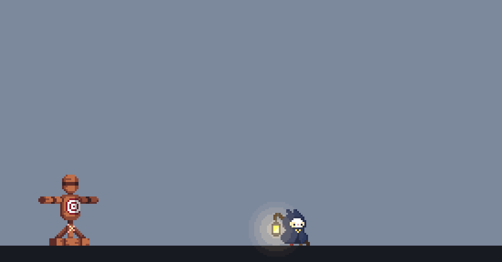

# Parton Desktop Pet

A small desktop pet for Windows, written in Python with Tkinter. Parton is the
"Little Axion" character from the *Luneblade* pack by Jesshiyoo. It lives on
your taskbar, hunts your mouse cursor with its axe and trains on a dummy.



*Recorded from the program itself, with a simulated cursor
(`tools/record_demo.py`). Art by Jesshiyoo (Parton) and Mattz Art (the dummy).*

## What it does

- **Wanders** along the bottom of the screen, standing on the taskbar: it
  idles for a few seconds, then runs to a random spot.
- **Trains** on the training dummy: now and then, when the dummy is close
  enough, Parton walks up to it and hits it a few times. Once in a while the
  dummy **hits back**: it swings on its post, takes half a heart from Parton
  and knocks him back, and a puzzled **"?"** floats up from his head.
- **Chases the cursor** when it sees it nearby (up to 450 px to either side
  and 250 px above the taskbar): a **"!"** pops over its head as it spots
  it. The cursor always comes before the dummy.
- **Attacks** with one of its two axe swings, picked at random, once the
  cursor is within reach.
- **Jumps** at the cursor when it is close but higher than the axe can reach,
  drifting towards it in the air, and **swings in mid-air** if it gets close
  enough.
- **Dashes back** when the cursor is right on top of it, to get the axe's
  distance, and then attacks.
- **Pick it up** by holding the left mouse button on it, and release it
  anywhere: it falls back down to the taskbar. Let go while moving the mouse
  and it is **thrown** that way, as fast as you were moving, bouncing off the
  screen edges. A **hard landing** hurts it.
- **Hit it** with a quick left click: it flinches and turns to face you. On
  the sixth hit it **dies** and disappears.
- **Heals** over time: after a few seconds without being hit, it recovers
  one hit at a time.
- **Runs away** from the cursor when it has only two hits left (dashing if
  the cursor is very close and hopping around to dodge your clicks), until it
  has healed a bit.
- **Dozes off** when the mouse hasn't moved or clicked for a minute (and
  nothing has hit it): it slumps where it
  stands, eyes closed, with "Z"s floating up from its head one after another,
  drifting the way it faces. Bring the cursor near (down on the taskbar next
  to it counts too) and it
  wakes up with a "!"; hitting it or picking it up also wakes it. Move the
  cursor **slowly** and you can sneak up on it: it sleeps on until the cursor
  touches it. In calm
  mode the cursor never wakes it: only a hit, picking it up or "Wake Parton"
  in the menu do. However it wakes up, a "!" pops over its head; woken by a
  hit, it also hops aside, startled, keeping its eyes on the cursor. In calm
  mode, rubbing the cursor over it for a couple of seconds bothers it: it
  wakes up ("!"), looks around dazed, walks a little way off and goes back to
  sleep there. The pack has no sleeping
  animation, so it uses the slumped frames from the death one.
- **Walks on your windows**: now and then it runs under a window nearby and
  jumps up onto its top, and it lands on window tops when it is thrown or
  falls. Up there it wanders along the window, and rides along when you move
  it. When the window closes, is minimized or maximized, another window
  covers the spot, or it walks off the edge, it drops down, unhurt. Only the
  parts of a window's top that can be seen count: any window in front
  (maximized ones too) covers the ones behind it.
- **Celebrates** with a couple of hops when one of its swings breaks the
  dummy.
- **Shows its health**: put the cursor over Parton and a row of hearts
  appears above its head. It has three, and each heart is two hits: the first
  turns it into a half heart, the second empties it.

### The training dummy

The dummy (`dummy.py`) comes up together with Parton, in the same program:

- It starts in the bottom-left corner of the screen, on the taskbar.
- **Hit it** with a quick left click.
  The yellow impact bursts from where it was hit (where you clicked, or
  where Parton's axe or Parton himself struck it), flying out on that side.
- **Pick it up and throw it** just like Parton, but it is **twice as heavy**:
  the same flick throws it half as fast, and it bounces less off the edges.
  Unlike Parton, landings don't hurt it.
- Thrown or dropped over a window, it **stays on top of it**, rides along
  when you move the window and falls when the window goes. Parton only
  trains on it when it is down on the taskbar.
- Put the cursor over it to see its health: seven hearts, two hits each.
- Your hits and Parton's add up, even while it is in the air: on the 14th it
  **breaks** and disappears, and **comes back** on its own 15 seconds later.

### Throwing them at each other

- Throw Parton hard at the dummy and the dummy takes a hit (Parton bounces
  off it).
- Throw the dummy hard at Parton, or drop it on him, and Parton takes a hit...
  unless he dodges: three times out of four he waits until the last moment
  and then **jumps over it** or **dashes out of the way**, whichever gets him
  clear. If it comes too close and too fast for either, he takes the hit.
- A dummy that hits Parton also **knocks him back**: he is pushed the way it
  was flying (or away from it, if it fell on him) with a little hop.
- A gentle toss doesn't hurt: from the side only the sideways speed counts,
  and falling on top of the other one, the whole speed. One hit per throw.

### The cursor

Over Parton or the dummy, the cursor turns into a **sword**: its tip is the
point you hit with. While you hold one of them it becomes a **closed hand**,
and when you let go it goes back to the sword. Over a dead Parton or a
breaking dummy there is nothing to hit, so it stays the normal arrow; so does
the menu. Both cursors are pixel drawings made by the program (`SWORD` and
`FIST` in `ui.py`) and saved as `.cur` files in `%APPDATA%\Parton\cursors`
when it starts.

### The menu

Right click on Parton or on the dummy, or click **Parton's icon in the
system tray** (next to the clock), to open a small menu of pixel-art buttons
(or the plain Windows menu if the font is missing). Click an option to pick
it; click anywhere else or press Escape to close it:

- **Revive** a character that has died (the dummy without waiting).
- **Hide** or **show** each one, to have only one of them on the screen. A
  hidden dummy doesn't come back on its own.
- **Sleep Parton** puts him to sleep right away (**Wake Parton** wakes him).
  The cursor, right next to him after using the menu, doesn't wake him as it
  leaves; once it has gone away, bringing it back near does.
- **Settings** opens the settings in the same spot; each one is switched on
  or off with a click (the settings stay open so you can see the change), and
  **Back** returns to the main menu:
  - **Calm mode** (off by default): Parton ignores the cursor, so he no
    longer chases or attacks it. You can still hit him.
  - **Do not disturb** (on by default): both hide while a full-screen app is
    in front (a game, a video, a presentation) and come back when it closes.
  - **Training** (on by default): Parton goes and hits the dummy now and then.
  - **Dummy hits back** (on by default): the dummy sometimes hits Parton back.
  - **Walk on windows** (on by default): Parton climbs onto and walks on the
    open windows. Off, he stays on the taskbar.
- **Exit** closes the program.

The settings are saved in `%APPDATA%\Parton\settings.json`, so they are kept
the next time it runs.

The tray icon is the way back when neither of them is on the screen (both
dead or hidden, or away for "do not disturb"): the program keeps running in
the tray until you pick **Exit**. Windows 11 puts new tray icons among the
hidden ones (the **^** arrow); drag it next to the clock to keep it in view.
If the tray isn't there, the program closes as soon as nobody is left on the
screen to right-click (unless the dummy is about to come back). Only one copy
of the program runs at a time.

## Requirements

- Windows 10 or 11
- Python 3.10 or newer, with Tkinter (included in the python.org installer)
- [Pillow](https://pypi.org/project/pillow/): `pip install -r requirements.txt`

## Sprites (not included)

The sprites are **not** in this repository: the packs' licenses do not allow
redistributing them. To get them:

1. Download the free **Luneblade – Little Axion** pack by Jesshiyoo from
   <https://jesshiyoo.itch.io/> and copy its PNG sprite sheets into
   `assets/parton/sprites/`.
2. *(Optional, for the dummy)* Download the free **Training Dummy 2D Pixel
   Art** pack by Mattz Art from <https://xzany.itch.io/> and copy its
   `IDLE.png`, `HIT.png` and `BREAKING.png` into `assets/dummy/sprites/`.
3. *(Optional, for the pixel-art menu)* Copy the **Nanofon** pixel font to
   `assets/ui/Nanofon.ttf`. The menu's buttons and the hearts are drawn by
   the program itself, so nothing else is needed.
```
assets/
├── parton/
│   └── sprites/
│       ├── Attack 1.png
│       ├── Attack 2.png
│       ├── Dash.png
│       ├── Death.png
│       ├── Fall.png
│       ├── Hurt.png
│       ├── Idle.png
│       ├── Jump.png
│       └── Run.png
├── dummy/
│   └── sprites/
│       ├── BREAKING.png
│       ├── HIT.png
│       └── IDLE.png
└── ui/
    └── Nanofon.ttf
```

If any of Parton's sprites is missing, it shows a message listing the missing
files. Without the dummy's sprites, Parton runs alone. Without the font, the menu
is the plain Windows one. The hearts and the cursors are drawn by the program
itself, so they need no files.

## Running it

```
pythonw parton.py
```

It brings up Parton and the dummy. `pythonw` runs it without a console
window; `python parton.py` also works.

## Tests

```
python -m unittest
```

It runs every test in `tests/` (about a minute and a half), with nothing to install:

- `test_physics.py`: throwing, falling, bouncing and the click-or-drag rule.
- `test_platforms.py`: which parts of the windows' tops Parton can stand on.
- `test_settings.py`: saving and loading the settings.
- `test_ui.py`: the menu, hearts, the "!", "?" and "Z", text and cursors.
- `test_app.py`: Parton and the dummy together (and the tray icon): walking on
  windows, chasing and calm mode,
  dozing off and waking up, the
  mid-air swing, dodging and knockback, the dummy hitting back, where the
  impacts land, the hearts, the cursors, the menu and settings, and do not
  disturb.

The tests simulate the cursor and the open windows (the real mouse is never
moved, and your windows are never looked at) and use a
temporary folder instead of your settings and cursor files. The ones in
`test_app.py` run the real program, so Parton and the dummy pop up on the
screen while they run; without the sprites they are skipped.

## Recording the demo GIF

```
python tools/record_demo.py
```

It records the scripted scene in `docs/demo.gif` (or the path you pass it).
Every frame is drawn from the program's own images on a plain backdrop, with
a simulated cursor: nothing is captured from your screen and the real mouse
is never moved. It takes about 15 seconds, with Parton and the dummy on the
screen meanwhile.

## Settings

The constants at the top of `parton.py` control its behavior:

| Setting | What it changes |
|---|---|
| `SCALE` | Size of the character on screen |
| `RUN_SPEED`, `CHASE_SPEED` | Speed when wandering and when chasing |
| `IDLE_SECONDS` | How long it idles before wandering |
| `VISION_RANGE`, `VISION_HEIGHT` | How far it can see the cursor |
| `ATTACK_REACH`, `ATTACK_HEIGHT`, `SLASH_CENTER` | How far and how high the axe slash reaches, and where it aims |
| `TOO_CLOSE`, `DASH_SPEED` | When it dashes back, and how fast |
| `JUMP_MAX_HEIGHT`, `JUMP_PAUSE` | Highest jump, and the rest between jumps |
| `AIR_ATTACK_FRAME_MS` | Speed of the mid-air swing |
| `AIR_ATTACK_FIRST_FRAME`, `AIR_ATTACK_LAST_FRAME` | Which frames of the swing it plays in mid-air (no wind-up or recovery on the ground) |
| `AIR_ATTACK_GRAVITY` | How slowly it drifts down while swinging in mid-air |
| `HITS_TO_DIE`, `DEATH_LINGER` | Hits it takes to die (keep it even: two hits per heart), and how long it lies there before disappearing |
| `HEAL_DELAY`, `HEAL_INTERVAL` | How long without being hit before it heals, and how often it heals a hit |
| `FLEE_AT`, `FLEE_DASH_DISTANCE` | With how many hits left it runs away, and how close the cursor must be for it to dash |
| `FLEE_JUMP_HEIGHT`, `FLEE_JUMPS_PER_SECOND` | Height of its dodging hops while fleeing, and how often it hops (cursor far / close) |
| `SLEEP_AFTER`, `WAKE_PAUSE` | How long the mouse must be still for it to doze off, and how long it takes to come round |
| `SNEAK_SPEED` | How slowly the cursor must move to sneak up on it asleep (it then wakes only when touched) |
| `STARTLE_PUSH`, `STARTLE_LIFT` | How far aside and how high it hops when a hit wakes it up |
| `NUDGE_SECONDS`, `SHUFFLE_DISTANCE`, `SHUFFLE_SPEED` | Calm mode: how long the cursor must rub it asleep before it gets up, and how far and how fast it walks off |
| `GROGGY_LOOKS`, `GROGGY_LOOK_SECONDS` | How many times it looks around, dazed, before walking off, and how long each look lasts |
| `Z_EVERY`, `Z_SECONDS`, `Z_RISE`, `Z_DRIFT` | How often a "Z" starts floating up while it sleeps, how long each lasts, and how far it rises and drifts sideways |
| `CELEBRATE_HOPS`, `CELEBRATE_HOP_HEIGHT` | How many hops it does after breaking the dummy, and how high |
| `TRAIN_CHANCE`, `TRAIN_RANGE` | How often it goes to train on the dummy, and from how far |
| `TRAIN_SWINGS`, `TRAIN_PAUSE` | How many swings per training session, and the pause between them |
| `EVADE_CHANCE`, `EVADE_MARGIN` | How often it dodges a thrown dummy (the rest of the time it takes the hit), and how close to the last moment it waits before dodging |
| `EVADE_JUMP_HEIGHT`, `EVADE_DASH_DISTANCE` | How high it jumps and how far it dashes to dodge |
| `KNOCKBACK_FACTOR`, `KNOCKBACK_MAX`, `KNOCKBACK_LIFT` | How hard a hit from the dummy pushes Parton (share of its speed, cap) and how much it pops him up |
| `COUNTER_CHANCE`, `COUNTER_DELAY_MS` | How often the dummy hits back after one of Parton's hits, and how long after |
| `COUNTER_REACH`, `COUNTER_PUSH`, `COUNTER_LIFT` | How close Parton must still be for it to reach him, and how hard it knocks him back |
| `FULLSCREEN_CHECK_MS` | How often "do not disturb" looks for a full-screen app |
| `PLATFORM_SCAN_MS`, `LEDGE_MIN` | How often it looks at where the windows are, and the narrowest stretch of a window's top it stands on |
| `CLIMB_CHANCE`, `CLIMB_MIN`, `CLIMB_HEIGHT`, `CLIMB_RANGE` | How often it jumps up onto a window when it would wander, and how low, how high and how far away that window's top can be |
| `CLIMB_OVERSHOOT` | How much higher than the window's top it jumps, to land on it |
| `STAY_CHANCE`, `WALK_OFF_SPEED` | On a window, how often it wanders along it rather than anywhere (maybe off it), and how fast it goes on as it walks off |

`physics.py` holds what Parton and the dummy share:

| Setting | What it changes |
|---|---|
| `GRAVITY` | How fast things fall |
| `THROW_FACTOR`, `THROW_MAX_SPEED` | How much of the mouse speed a throw keeps, and its cap |
| `THROW_FLICK_SPEED`, `THROW_FLICK_FACTOR` | From what mouse speed sharp flicks get stronger, and how much |
| `AIR_DRAG`, `WALL_BOUNCE` | How quickly a throw slows down, and how much it bounces off the edges |
| `IMPACT_SPEED`, `IMPACT_BOUNCE` | How fast a thrown body must hit the other one to hurt it, and how much it bounces off |
| `FALL_DAMAGE_SPEED` | How fast a landing must be to hurt Parton |
| `DRAG_THRESHOLD`, `AIR_DRAG_THRESHOLD`, `HOLD_SECONDS` | How far you must move (on the ground / in the air), or how long you must hold, for a click to become a grab |

The dummy has its own settings at the top of `dummy.py` (`SCALE`,
`HITS_TO_DIE`, `RESPAWN_SECONDS`, `WEIGHT`, `HIT_CACHE_SIZE`, animation speeds and its starting distance from the
screen edge).

`ui.py` draws the menu and the hearts: `UI_SCALE` sets their pixel size
(keep it the same as the characters' `SCALE`), `HEART` is the heart's drawing, `TEXT_SCALE` the pixel size of
the menu's text (half the characters', so the buttons stay small), `HEARTS_GAP` how far above the head
the hearts sit and `HEART_GAP` the space between hearts. `EXCLAMATION`,
`QUESTION` and `SLEEP_Z` are the "!", "?" and "Z" drawings, and `EMOTE_SECONDS`, `EMOTE_RISE`
and `EMOTE_FADE_FROM` how long they last, how far they float up and when they
start fading.

`screen.py` holds what all of them share to draw on the screen (the
transparent color, where the cursor and the taskbar are), `tray.py` the
tray icon and `platforms.py` where the windows' tops are (and which parts of
them are covered by windows in front). `TRAY_SIZES`, `TRAY_HEAD` and `TRAY_OUTLINE` in `parton.py` set how
the icon is drawn: at 16 px only Parton's head fits.

## Credits

- Parton art by [Jesshiyoo](https://jesshiyoo.itch.io/).
- Dummy art by [Mattz Art](https://xzany.itch.io/).
- Nanofon pixel font.

## License

The code is released under the [MIT License](LICENSE). The license covers the
code only: the art belongs to its authors and is subject to their own
licenses, which do not allow redistributing it.
